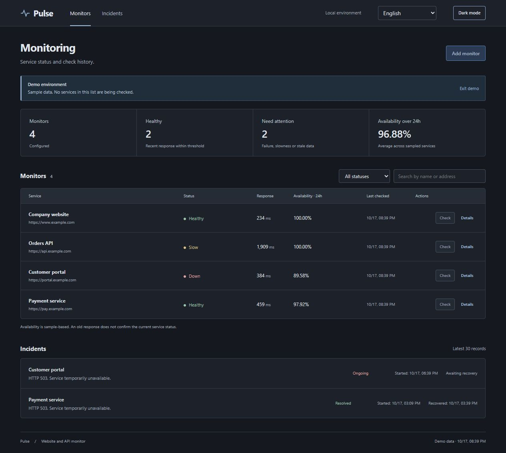

# Pulse — Website & API Monitor

A lightweight uptime monitor built with **PHP, vanilla JavaScript and SQL**. Track HTTP availability, response times and incident recovery from a local dashboard.

Built by [Moisés Gorisch](https://github.com/MoisesGorisch) as a portfolio project connecting IT operations, web development and automation.



## Features

- Create up to 20 monitors with a URL, check interval, slow-response threshold and optional expected response text.
- Perform manual checks or run the CLI collector on a schedule.
- See the latest state, sample-based availability and recent response-time history.
- Open an incident on failure and close it when the endpoint recovers, including slow but successful responses.
- Explore a separate, read-only demonstration with fictional data using `?demo=1`.
- Use SQLite for a zero-setup local database; PDO MySQL configuration is also available.
- Responsive dashboard in Brazilian Portuguese; project documentation in English.
- Compact service list, state/search filters and expandable diagnostic history.
- Light/dark themes with a local browser preference and system-theme fallback.
- Stale-data warnings when checks stop arriving; failed connections do not show misleading response times.
- System fonts and local assets only; no external frontend requests.

## Requirements

- A maintained PHP 8.2+ release with cURL and PDO SQLite (or PDO MySQL). Local review used PHP 8.4.26.
- A modern browser.
- No Composer, npm packages or frontend build step.

## Run on Windows

Open PowerShell in the project directory:

```powershell
.\Start.ps1
# Or select your PHP installation:
.\Start.ps1 -PhpPath 'C:\path\to\php.exe' -Port 8787
```

Visit **http://127.0.0.1:8787**. The script starts the web server and a collector that checks for due monitors every 15 seconds. Keep the terminal open. A monitor is first checked on the next collector pass; later checks follow its configured interval. Closing the launcher stops automatic checks.

The launcher loads the required extensions independently of the machine's php.ini and does not modify the existing PHP installation. It prefers a portable PHP at `.runtime/php/php.exe`, then PHP on PATH, then `C:\SFTP\xampp\php\php.exe`. The portable runtime is ignored by Git and is not distributed with this repository. Download a current supported Windows build from [PHP](https://www.php.net/downloads.php), verify its published SHA-256 and extract it into `.runtime/php/`, or pass `-PhpPath` to your maintained installation.

### Manual / Linux setup

With the required extensions enabled:

```sh
php -S 127.0.0.1:8787 -t public router.php
# In another terminal, run once, or schedule every minute:
php bin/check.php
```

Serve **only `public/`**. Never use the repository root as the document root. The database and configuration belong outside the public directory.

## Database

By default, the app creates `var/monitor.sqlite`. Runtime files and `config.local.php` are excluded from Git.

For MySQL, create an empty database, copy `config.example.php` to `config.local.php`, then configure:

```php
<?php
return [
    'dsn' => 'mysql:host=127.0.0.1;dbname=pulse;charset=utf8mb4',
    'db_user' => 'your_database_user',
    'db_password' => 'your_database_password',
];
```

Tables are created automatically. Switching database connections does not migrate existing history. The SQLite path is tested locally; MySQL support is provided but has not yet been validated against a running MySQL server.

## Status and availability

| State | Meaning |
|---|---|
| Available | HTTP 2xx and optional expected text found, within the latency threshold |
| Slow | Successful response above the configured threshold |
| Down | HTTP error, connection/TLS/timeout failure, blocked address, oversized body or missing expected text |
| Pending | No checks recorded |

Availability is the proportion of successful samples in the last 24 hours; slow responses count as available. It is **not time-weighted uptime or an SLA measurement**. Summary availability averages each sampled monitor's percentage. The dashboard renders up to 100 recent samples per monitor; availability uses all samples in the 24-hour window. The collector retains checks for 90 days. Incidents remain until the database is managed manually.

## Network and security boundaries

- This MVP is a **local administration application**, not a publicly exposed multi-user service. The API accepts loopback connections and localhost Host headers only. Do not put it behind a public reverse proxy without adding authentication and enforcing access controls.
- Mutations require a session-bound CSRF token. Monitor names and response messages are rendered as text, never HTML.
- JSON bodies are capped at 8 KB, text fields reject structured values, and mutation requests enforce their origin and content type.
- The local router serves an explicit list of public routes with a restrictive Content Security Policy, framing restrictions and privacy headers. Use `Start.ps1` or the documented router command; production servers require equivalent configuration.
- Only public IPv4 HTTP/HTTPS endpoints on ports 80/443 are checked. Internal, loopback, link-local, shared-address and multicast destinations are rejected.
- Hostnames are resolved before connecting and pinned with cURL's `CURLOPT_RESOLVE`; proxies and redirects are disabled. Use the final URL rather than a redirecting address.
- Requests verify TLS, time out after 10 seconds and stop after 1 MB of response body. IPv6-only targets are not supported yet.
- On Windows, supported cURL builds use the native Windows certificate store; Linux relies on its configured CA bundle. Certificate verification is never disabled.
- Requests do not carry credentials, custom headers or POST bodies. Query strings are stored with the URL; do not enter secrets in URLs.
- Shared file locking prevents concurrent collectors/manual checks. Checks run sequentially, so many slow endpoints can delay later checks.
- The frontend has no external font, stylesheet or script dependencies.

Read the scoped [security review and remaining limitations](docs/security-review.md) before changing the deployment model. A local review is not a security certification.

## Verification

```sh
php tests/run.php
node --check public/app.js
# PowerShell: with the local app running
.\tests\http.ps1
```

Core tests use a disposable in-memory database and cover URL/address rejection, malformed field types, incident deduplication, recovery, scheduling and availability calculation. The HTTP regression script makes no data changes and covers request rejection, private-route protection and response headers. The demo never inserts fictional records into the real database.

## Structure

```text
public/          Browser dashboard and local JSON API
src/             Persistence, validation and HTTP checking
bin/check.php    Scheduled CLI collector
tests/           Core regression tests
var/             Ignored local database and lock
docs/            Portfolio screenshots
```

## Roadmap

- Authenticated remote administration and a separate public status page.
- Edit, pause and archive monitors.
- Email/webhook alerts with retry handling.
- MySQL integration tests and database migrations.
- Internationalization and configurable incident confirmation thresholds.

## License

MIT — see [LICENSE](LICENSE).
